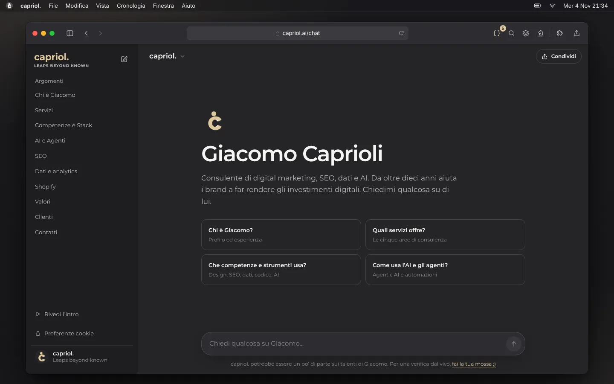
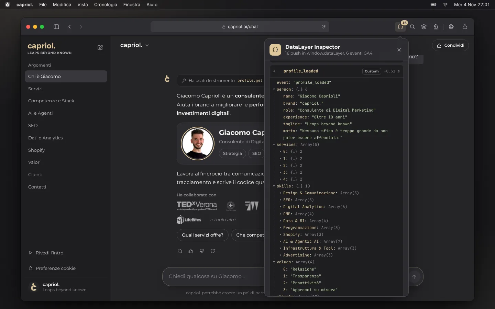
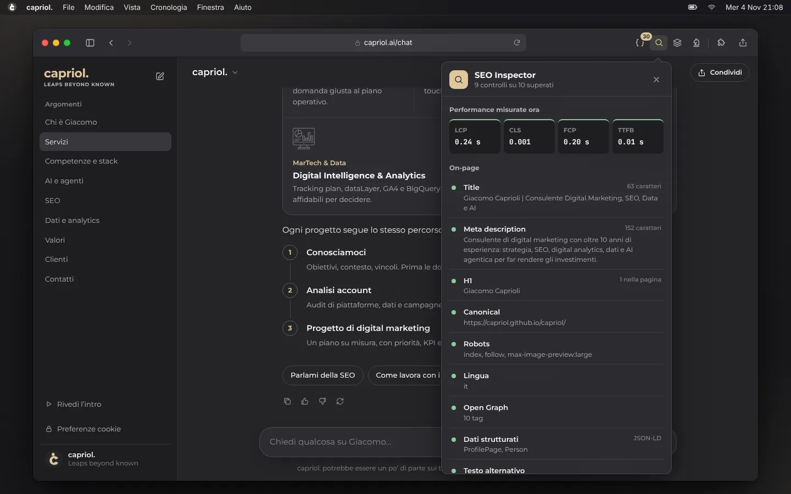
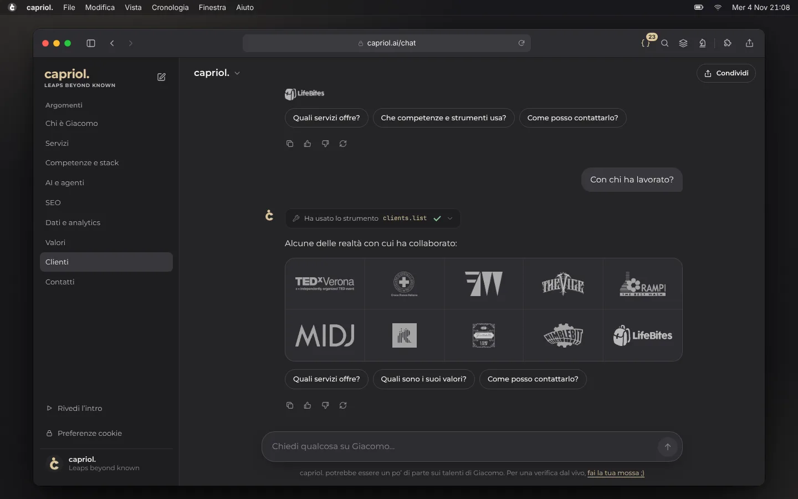

# Giacomo Caprioli

**Consulente di digital marketing. SEO, digital analytics, dati e AI agentica.**

*capriol. Leaps beyond known.*

---

Da oltre dieci anni aiuto i brand a **far rendere gli investimenti digitali**: capire cosa funziona, misurarlo bene e migliorarlo.

Ho un profilo ibrido, e lo considero il mio vantaggio:
- **Strategia:** parlo la lingua del marketing.
- **Dati:** costruisco il tracciamento che serve a decidere.
- **Prodotto:** disegno l'interfaccia e scrivo il codice quando serve.
- **AI:** collego i modelli linguistici ai dati veri del business.

> Nessuna sfida è troppo grande da non poter essere affrontata.

 

## Cosa porto in un team

| Area | Cosa faccio, in concreto |
|---|---|
| **Advisory** | Strategia digitale, audit di account e piattaforme, affiancamento al team dalla domanda giusta al piano operativo |
| **Digital Intelligence & Analytics** | Tracking plan, design del dataLayer, GA4 e Google Tag Manager, Consent Mode v2, BigQuery e SQL, dashboard per il business |
| **SEO** | SEO tecnica e on-page, architettura dei contenuti, dati strutturati, Core Web Vitals, visibilità nelle risposte delle AI |
| **AI & Agentic AI** | Flussi agentici che collegano LLM a dati e strumenti (MCP), automazioni per report, analisi e contenuti |
| **Online Advertising** | Campagne a performance su Google e Meta, gestione del budget, misurazione dei risultati |
| **Comunicazione & Design** | Brand identity, graphic design, UX/UI, copywriting e content strategy coerenti su ogni touchpoint |

 

## Questo repository è il mio portfolio

Invece di descrivere le mie competenze, ho costruito una pagina che le usa. **[capriol.github.io/capriol](https://capriol.github.io/capriol/)** è un browser macOS che naviga su un LLM addestrato su di me. Le estensioni del browser analizzano la pagina stessa, dal vivo.

  

Ogni dettaglio è una competenza messa alla prova:

| Nella pagina | La competenza dietro |
|---|---|
| **DataLayer Inspector**: ogni interazione genera un evento custom e, dove esiste, il suo gemello **GA4 consigliato** con parametri standard (`search`, `select_content`, `view_item_list`, `generate_lead`, `share`, `tutorial_begin`…), con il link alla documentazione Google | Digital analytics, tracking plan, GTM |
| **Consent Mode v2** con richiesta di permesso in stile Safari, consensi `denied` di default e scelta persistente | Privacy by design, conformità GDPR |
| **SEO Inspector**: legge meta, canonical, JSON-LD e misura LCP, CLS, FCP e TTFB con `PerformanceObserver` | SEO tecnica, performance |
| `ProfilePage` + `Person` in JSON-LD, `llms.txt`, accesso esplicito ai crawler AI | AI search visibility |
| Interfaccia da LLM con streaming, tool call, suggerimenti e feedback, scritta senza API esterne | UX per prodotti AI |
| Design system ricavato dalla mia brand identity: antracite `#252528`, oro `#DEC79B`, Montserrat | Design, brand identity |
| Zero framework, zero dipendenze: HTML semantico, CSS moderno, ES modules. Font self-hosted, circa 600 KB in tutto, navigabile da tastiera, `prefers-reduced-motion` rispettato | Sviluppo front-end, accessibilità |

<table>
  <tr>
    <td width="50%"></td>
    <td width="50%"></td>
  </tr>
  <tr>
    <td align="center">Il mio profilo, in formato dati</td>
    <td align="center">La pagina che si analizza da sola</td>
  </tr>
</table>

<b>Per chi lavora con i dati: la tassonomia degli eventi</b>

 

Ogni evento custom porta il parametro `ga4_event`, che rimanda al suo gemello GA4 inviato subito dopo. Prima di ogni oggetto `ecommerce` c'è il reset `{ ecommerce: null }`, come raccomanda Google.

| Evento custom | Evento GA4 | Parametri GA4 |
|---|---|---|
| — | `page_view` | `page_title`, `page_location`, `page_path`, `page_referrer`, `language`, `screen_resolution`, `content_group` |
| `chat_prompt` (domanda scritta) | `search` | `search_term` |
| `chat_prompt` (suggerimento) | `select_content` | `content_type: chat_suggestion`, `content_id` |
| `chat_response` (servizi, clienti, competenze) | `view_item_list` | `item_list_id`, `item_list_name`, `items[]` con `item_id`, `item_name`, `item_brand`, `item_category`, `item_category2`, `index` |
| `extension_open` | `select_content` | `content_type: browser_extension`, `content_id` |
| `client_click` | `select_content` | `content_type: client`, `content_id` (+ `link_url`, `link_domain`, `outbound`) |
| `contact_click` | `generate_lead` | `lead_source`, `currency`, `value` |
| `share_click` | `share` | `method`, `content_type`, `item_id` |
| `intro_start` / `intro_complete` | `tutorial_begin` / `tutorial_complete` | |
| `profile_loaded`, `chat_feedback`, `chat_reset`, `consent_update`, `intro_skipped` | — | Custom: nessun equivalente GA4 |

 

## Come lavoro

1. **Conosciamoci.** Obiettivi, contesto, vincoli. Prima le domande giuste, poi le risposte.
2. **Analisi account.** Audit di piattaforme, dati e campagne per capire dove si perde valore.
3. **Progetto di digital marketing.** Un piano su misura, con priorità, KPI e responsabilità chiare.

**Relazione**, **trasparenza**, **proattività** e **approcci su misura**: niente pacchetti standard, si parte sempre dal tuo contesto.

 

## Stack

| | |
|---|---|
| **Analytics** | Google Analytics 4 · Google Tag Manager · Consent Mode v2 · DataLayer design |
| **Data** | BigQuery · SQL · Dashboarding |
| **SEO** | Google Search Console · Dati strutturati schema.org · Core Web Vitals · AI search visibility |
| **AI** | LLM · Prompt engineering · Agentic workflows · MCP · Automazioni |
| **Advertising** | Google Ads · Meta Ads |
| **Sviluppo** | HTML · CSS · JavaScript |
| **Design** | Brand identity · Graphic design · UX / UI |

 

## Hanno lavorato con me

TEDxVerona · Croce Rossa Italiana · [Fondazione Architetti Mantova](https://fondazionearchitettimantova.it) · [The Vice](https://the-vice.it) · Rampi · MIDJ · Radio Iusve · Portobello Vintage & Riuso · NimbleBit · LifeBites

  

 

## E ora fai la tua mossa ;)

Sono aperto a nuovi progetti di consulenza e a collaborazioni con team marketing, data e prodotto.

- **Email:** [giacomo.caprioli@gmail.com](mailto:giacomo.caprioli@gmail.com)
- **Telefono:** (+39) 347 0348852
- **LinkedIn:** [linkedin.com/in/giacomo-caprioli](https://www.linkedin.com/in/giacomo-caprioli/)

 

<b>In English</b>

 

I'm **Giacomo Caprioli**, an Italian digital marketing consultant with 10+ years of experience. I help brands get more out of their digital investments.

- **What I do:** marketing strategy, technical SEO, digital analytics (GA4, GTM, dataLayer design, BigQuery/SQL) and agentic AI workflows.
- **This repository:** my portfolio, built as a working demo. It's a fake macOS browser running an LLM trained on me, with browser extensions that inspect the page live: a real `window.dataLayer` mapped to GA4 recommended events, an SEO auditor with Core Web Vitals, Consent Mode v2 and structured data.
- **How it's built:** zero dependencies, accessible, about 600 KB.

Open to consulting projects and collaborations. Reach me at [giacomo.caprioli@gmail.com](mailto:giacomo.caprioli@gmail.com) or on [LinkedIn](https://www.linkedin.com/in/giacomo-caprioli/).

---

Codice sotto licenza MIT. Brand, contenuti e foto © Giacomo Caprioli. I loghi dei clienti appartengono ai rispettivi proprietari.

